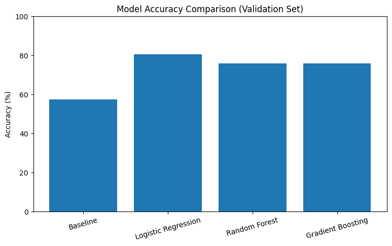

# Pothole Detection Using Machine Learning

## Project Overview
This project uses machine learning to classify road images into two categories: **Pothole** and **Normal**. The goal is to explore image preprocessing, model training, evaluation, and comparison.

## Dataset
The dataset contains road images organized into training, validation, and test sets.

| Split | Images |
|---|---:|
| Training | 1,157 |
| Validation | 108 |
| Testing | 136 |
| **Total** | **1,401** |

Images were resized to 64 × 64 pixels, converted to RGB, and normalized by dividing pixel values by 255. Test labels were assigned using the filename prefixes.

## Models Evaluated
The following models were compared:

- Logistic Regression
- Random Forest
- Gradient Boosting
- Dummy Classifier (baseline)

## Results

### Validation Accuracy

| Model | Accuracy |
|---|---:|
| Logistic Regression | 80.56% |
| Random Forest | 75.93% |
| Gradient Boosting | 75.93% |
| Dummy Classifier | 57.41% |

Logistic Regression performed best on the validation set and was selected for final testing.

### Test Results

The selected Logistic Regression model achieved **88.24% test accuracy**, correctly classifying 120 out of 136 test images.

| Metric | Pothole | Normal |
|---|---:|---:|
| Precision | 0.81 | 0.98 |
| Recall | 0.98 | 0.79 |
| F1-score | 0.89 | 0.88 |

### Confusion Matrix

### Model Comparison

## Key Learnings
- Preparing and preprocessing image data for machine learning.
- Converting images into numerical features.
- Training and comparing multiple classification models.
- Evaluating models using accuracy, precision, recall, F1-score, and a confusion matrix.
- Using a baseline model to understand whether trained models provide an improvement.

## Limitations
- The models use flattened pixel values rather than advanced image features or a convolutional neural network.
- The dataset may not represent all real-world road conditions.
- Further testing is needed before considering real-world deployment.

## Tools and Technologies
- Python
- Google Colab
- NumPy
- Matplotlib
- Scikit-learn
- PIL (Pillow)

## Future Improvements
- Try a Convolutional Neural Network (CNN).
- Test on images collected in different lighting and weather conditions.
- Investigate duplicate images and possible overlap between dataset splits.
- Improve performance on normal-road images.

## Author
Created as a beginner machine learning portfolio project.
